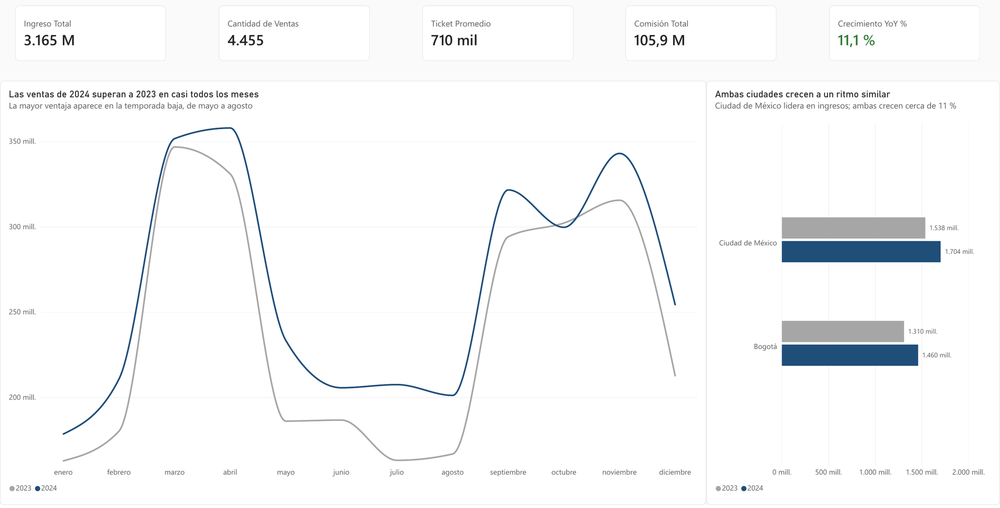
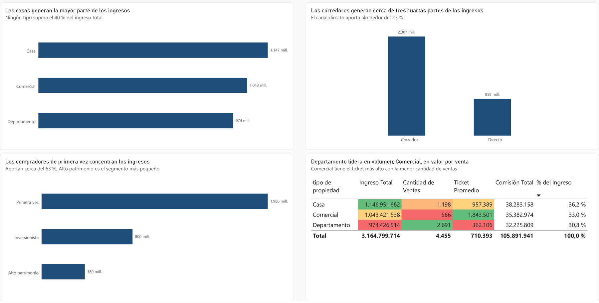
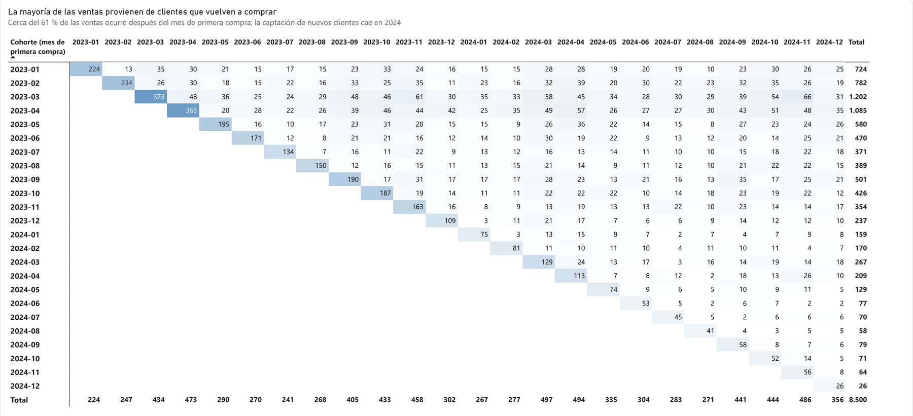

# Dashboard comercial inmobiliario: Andes Capital Real Estate

Dashboard ejecutivo en Power BI para una inmobiliaria con operación en Ciudad de México y Bogotá: desempeño general, análisis comercial por tipo de propiedad, canal y segmento, inteligencia de tiempo y análisis de cohortes de clientes (2023–2024).

**Resultado principal:** el ingreso creció 11,1 % en 2024 (de 2.847,7 a 3.164,8 millones), pero el crecimiento depende de clientes que vuelven a comprar: cerca del 82 % de las ventas de 2024 vino de clientes antiguos y la captación de nuevos cayó con fuerza.

[Documentación completa del proyecto](documentacion.md) · [Descargar el dashboard (.pbix)](dashboard_andes_capital.pbix)

## Preguntas de negocio

- **Desempeño general:** ingreso total, propiedades vendidas, precio promedio y comisión total.
- **Análisis comercial:** qué tipo de propiedad, canal y segmento de cliente generan más ingresos.
- **Análisis temporal:** evolución de las ventas, crecimiento año contra año y acumulado del año (YTD).
- **Cohortes:** si los clientes vuelven a comprar y qué cohortes generan más ventas con el tiempo.

## Dashboard



*Overview Ejecutivo (2024). Ingreso de 3.165 millones, 4.455 ventas y crecimiento de 11,1 %; las ventas de 2024 superan a las de 2023 en casi todos los meses.*



*Análisis Comercial (2024). Casa lidera el ingreso, el canal Corredor genera cerca de tres cuartas partes y Comercial tiene el ticket más alto con la menor cantidad de ventas.*



*Análisis de Cohortes. Cada fila es el mes de primera compra; los valores a la derecha de la diagonal son clientes que vuelven a comprar. Las cohortes de 2024 son mucho más pequeñas.*

## Hallazgos

| Tema | Hallazgo |
|---|---|
| Desempeño general | 6.012,5 millones en 8.500 ventas, con un ticket promedio de 707 mil y comisiones por 200,6 millones (cerca del 3,3 % del ingreso). |
| Tipo de propiedad | Casa genera el mayor ingreso (37 %), pero la participación es equilibrada (Comercial 32 %, Departamento 31 %). Departamento concentra el volumen (60 % de las ventas) y Comercial tiene el ticket más alto (más de 1,7 millones) y el mayor crecimiento (+18 %). |
| Canal | El Corredor genera cerca del 73 % del ingreso; el canal directo, el 27 %. |
| Segmento | Primera vez concentra cerca del 63 % del ingreso. Inversionista es el que más crece (+19 %) y Alto patrimonio se estanca (+0,5 %). |
| Tiempo | Crecimiento de 11,1 % en 2024, impulsado por la temporada baja (mayo a agosto). Picos en marzo–abril y septiembre–noviembre. |
| Cohortes | Cerca del 61 % de las ventas ocurre después del mes de primera compra. Las cohortes de marzo y abril de 2023 superan las 1.000 ventas acumuladas cada una, mientras las de 2024 son mucho más pequeñas (26 a 129 ventas iniciales frente a 150 a 370 en 2023). |

### Recomendaciones

1. Priorizar la comercialización de propiedades comerciales, que combinan el ticket más alto con el mayor crecimiento.
2. Fortalecer el canal Corredor y evaluar incentivos para el canal directo, que no paga intermediación.
3. Reactivar la captación de nuevos clientes y replicar con las cohortes recientes lo que funcionó con las de inicios de 2023.
4. Desarrollar una oferta para el segmento Inversionista y revisar la propuesta de valor para Alto patrimonio.
5. Planificar campañas antes de las temporadas altas y acciones para sostener la venta en los meses bajos.

## Cómo se construyó

- **Datos:** tabla de hechos `hecho_ventas_propiedades` (8.500 ventas) y dimensiones `dim_clientes` (3.500 clientes) y `dim_propiedades` (8.000 propiedades). Validación sin nulos ni claves duplicadas; se corrigió `porcentaje_comision`, que la configuración regional leía como entero.
- **Tabla calendario** `dim_fecha` con DAX (`CALENDAR` y `ADDCOLUMNS`), dinámica entre la primera y la última venta.
- **Modelo estrella** con relaciones 1:* activas y de dirección única.
- **Medidas DAX:** medidas base, participación % con `CALCULATE` y `ALL`, inteligencia de tiempo (`TOTALYTD`, `TOTALMTD`, `SAMEPERIODLASTYEAR` y crecimiento YoY) y columnas calculadas para cohortes con `ALLEXCEPT`.
- **Reporte de tres páginas:** Overview Ejecutivo, Análisis Comercial (con tabla semáforo y tooltips de participación) y Análisis de Cohortes (matriz con mapa de calor).

Las fórmulas, las decisiones de modelado y el resumen ejecutivo completo están en la [documentación](documentacion.md).

## Estructura del repositorio

```
dashboard_andes_capital/
├── dashboard_andes_capital.pbix   Dashboard en Power BI
├── documentacion.md               Proceso completo, fórmulas DAX y resumen ejecutivo
├── img/                           Capturas del dashboard
└── README.md
```

Para explorar el dashboard, descarga el archivo `.pbix` y ábrelo con Power BI Desktop. Los datos son un caso de estudio del bootcamp de Análisis de Datos de TripleTen.

## Herramientas

Power BI Desktop · Power Query · DAX · modelado dimensional

## Autor

**Felipe Vásquez Torres**, analista de datos con experiencia en supply chain y operaciones.

[LinkedIn](https://www.linkedin.com/in/felipe-vasquez-torres) · [Portafolio](https://fvt1999pipe-eng.github.io) · fe.vasqueztorres@gmail.com
